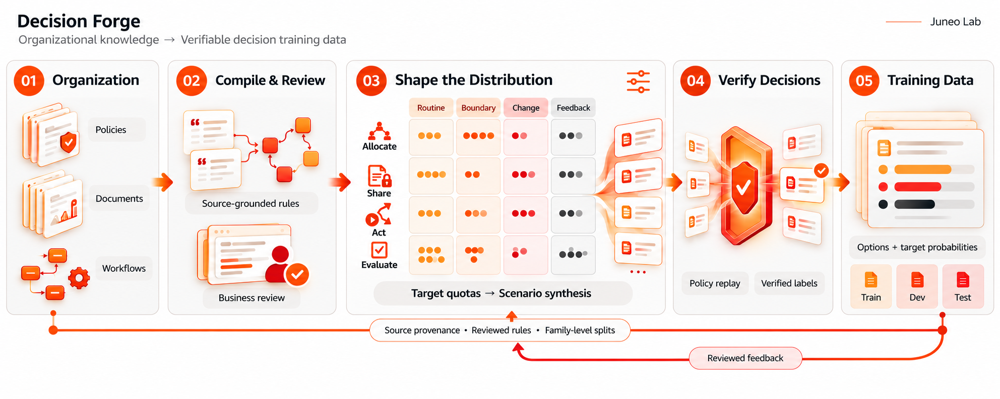

# Decision Forge

[](https://github.com/Juneo-Lab/decision-forge/actions/workflows/ci.yml)
[](docs/index.md)
[](pyproject.toml)
[](LICENSE)
[](ROADMAP.md)

**English** · [简体中文](README.zh-CN.md)

**Compile organizational policy into verifiable decision training data.**



Organizational decisions depend on policies, thresholds, escalation rules, and acceptance criteria
recorded in handbooks, SOPs, and workflow definitions. Decision Forge turns that knowledge into
reproducible supervision for decision models.

The document compiler proposes a rule specification with source quotations for business review.
The data pipeline evaluates scenarios against the approved rules and exports decision examples with
verified labels, source provenance, and stable family assignments. The result is training data you
can audit, reproduce, and hand to a trainer.

**Status: `v0.3.0` alpha — organizational decision data pipeline.**
Reviewed or authored specifications build into training data locally, without model credentials.
Document compilation and model-assisted synthesis use an explicitly selected model endpoint.
See [project status](docs/status.md) for the current implementation and next milestones.

| Capability | Implementation |
| --- | --- |
| Offline data path | reviewed rules → scenarios → verified labels → exports |
| Labels | recomputed from declared rules by a deterministic interpreter |
| Provenance | verified rule quotations and source hashes; corpus compilation adds spans and locators |
| Validation | 256 tests, 88.18% statement coverage in the full optional-adapter environment |
| CI | 10 jobs across Linux and macOS, including adapter, OCR, and Harbor controls; CodeQL and OpenSSF Scorecard scans |
| Training | four export formats, including the candidate-readout decision contract |
| Language | Python 3.11+ |

## The four decision surfaces

The pipeline organizes workflow decision points into four surfaces:

| Surface | Question the model learns to answer |
| --- | --- |
| **Allocate work** | Which person or agent should own this task? |
| **Share information** | Which recipient may receive which information? |
| **Select actions** | Should the workflow execute, adjust, or request authorization? |
| **Evaluate outcomes** | Does the deliverable meet the acceptance criteria? |

## Quickstart

Requires Python 3.11+ and [uv](https://docs.astral.sh/uv/). No API keys, no model downloads.

```bash
git clone https://github.com/Juneo-Lab/decision-forge
cd decision-forge
uv sync --group dev

uv run decision-forge validate examples/customer_support/project.yaml
uv run decision-forge build    examples/customer_support/project.yaml --output runs/demo
uv run decision-forge export   runs/demo --output runs/demo-decision --format decision
```

The fictional `Northstar Support` example is deliberately small (one handbook, ~1.2 KB of policy) and
produces a complete, verified dataset:

| Output | Value |
| --- | --- |
| Accepted episodes | 336 (requested 336, realized 336) |
| By surface | 96 allocate · 96 share · 96 act · 48 evaluate |
| By split | 196 train · 84 development · 56 test, assigned per family |
| Rejected for having no permitted choice | 0 |
| Model calls | 0 |

Artifacts in `runs/demo/`: `episodes.jsonl`, `rejected.jsonl`, `distribution.json`, `dedup.json`,
`report.json`, `report.md`, a hash-bound `project.snapshot.json`, and an integrity-checked
`manifest.json`. Rebuilding reuses content-addressed scenario caches; changing an input is detected
and refused rather than silently mixed into the old run.

## Why the data is trustworthy

Each published scenario label is recomputed by the policy interpreter. Source checks and review
records connect the declared rules to the organization's documents.

| Property | How it is enforced |
| --- | --- |
| **Policy-verified labels** | A deterministic interpreter applies priority, deny precedence, and set-valued ties to every candidate. Synthesis proposes states; the interpreter supplies their labels. |
| **Source-grounded rules** | Evidence quotations are validated against source text, allowing whitespace normalization. `compile-corpus` recomputes spans and source locators from extracted claims. |
| **Content-bound review** | Compiler output is a draft. Builds require accepted decisions for all current review items: rules, nodes, conflicts, and `dataset:recipe`. Authored specifications remain usable directly. |
| **Family isolation** | Related variants share a split. Duplicate detection keeps the held-out copy and reports cross-split overlap. Expansion imports validate current scenario/family/split lineage. |
| **Checkpoint recovery** | Completed extraction chunks and accepted synthesis records are reused. Failed or interrupted calls retain their budget reservations; a response lost before checkpointing may require another call. |
| **Bounded corpus compilation and synthesis** | `compile-corpus` reserves budgets per HTTP attempt. `expand` reserves logical proposal calls and their input bytes; response-mode fallback may issue multiple HTTP attempts within one proposal call. Both retain budget journals and support explicit budget increases for resumption. |
| **Visible distribution gaps** | Requested and realized quotas, rejected proposals, and remaining shortfalls are reported. Only verified examples enter the dataset. |

## Training handoff

Four export formats preserve the run's family split assignments. `canonical` retains set-valued
labels; the other formats omit rows with multiple valid choices, which can also omit entire families:

| Format | Shape | Use |
| --- | --- | --- |
| `decision` | Explicit `options` + aligned `target_probs`, family grouping, provenance | Candidate-readout training (recommended) |
| `canonical` | Input/target pair, set-valued labels preserved | Custom pipelines that keep ambiguity |
| `typed` | Choice question with per-candidate criteria | Constrained decoding / evaluation harnesses |
| `sft` | Chat messages with a single answer | Reference SFT baseline |

```bash
uv run decision-forge export runs/demo --output runs/train --format decision
uv run python scripts/finetune_evaluation.py prepare runs/demo --output runs/plan --budget-examples 2000
```

The `decision` format emits `objective: candidate_readout` rows with unit weights and provenance.
[`decision_forge.training.encode_decision`](docs/decision-training.md) turns them into a native
non-thinking prefix: single-token candidate labels, target probabilities moved together with the
candidate order, no answer token appended, and truncation rejected rather than silently applied. A
trainer that only minimizes ordinary answer-token SFT loss cannot consume this encoding — the contract
states the required objective explicitly.

`scripts/finetune_evaluation.py prepare` writes selected training rows, their IDs and file digests,
and the required training objective. `evaluate` scores an explicitly selected endpoint on held-out
cases; `compare` requires the same dataset, case order, and prompt. Fixed-budget training and measured
decision-quality gains are the next evaluation milestone.

## Compile your own documents

```bash
export FORGE_API_KEY="your-provider-key"
uv run decision-forge compile-corpus ./private/corpus.yaml --output runs/acme \
  --base-url https://your-model-host.example/v1 --model your-model

uv run decision-forge review-status runs/acme/project.json
uv run decision-forge review-record runs/acme/project.json \
  --item ITEM_ID_FROM_REVIEW_STATUS --decision accepted \
  --reviewer you --reason "Explain the evidence supporting this specific item." \
  --fingerprint FINGERPRINT_FROM_REVIEW_STATUS
# Review every rule, node, conflict, and dataset:recipe item using its returned ID and fingerprint.
# Build after review-status reports ready: true.
uv run decision-forge review-status runs/acme/project.json
uv run decision-forge build runs/acme/project.json --output runs/acme-data
```

Create `corpus.yaml` using the [corpus manifest format](docs/organization-compiler.md). Text,
Markdown, JSON, YAML, PDF, DOCX, XLSX, PPTX, HTML, CSV/TSV, and OCR image inputs carry version and
access metadata. Install `documents` for native office/PDF parsing and `ocr-rapid` for local
PP-OCR small models. [Document formats and OCR](docs/document-ingestion.md) covers automatic format
detection, Tesseract, and explicit vision OCR service configuration.
Extraction is chunked and resumable; assembly requires rule evidence to resolve to extracted claims.
Invalid schemas and ambiguous quotations produce validation errors; policy conflicts enter the review
queue for adjudication. Source snapshots and parsed generated objects are stored in private local
artifacts, including caches and repair records. Provider credentials stay outside those artifacts.

An optional [recipe planner](docs/generation.md) turns a requested distribution into exact per-cell
quotas, measures what the deterministic pool can supply, and separates work a model could do from work
only more source material can do. Verified synthesis (`expand`) then publishes only proposals whose
label is replayed from the declared policy.

## Evidence

**Local validation (macOS ARM64, Python 3.12, all optional extras):** 256 tests, 88.18% statement
coverage, Ruff, strict mypy, strict
MkDocs, wheel and sdist builds. CI runs 10 checks: quality, six test jobs (Ubuntu and macOS × Python
3.11/3.12/3.13), pinned Data Designer and LangGraph adapter contracts, and Harbor task execution in
Docker under oracle and no-op controls, plus real local OCR inference and seven-format ingestion.
CodeQL and OpenSSF Scorecard scan the repository on pull requests and on a schedule.

**Local OCR:** the [seven-format ingestion smoke test](experiments/2026-11-ingestion/README.md)
archives native file parsing and exact PNG/scanned-PDF transcriptions using bundled PP-OCR small
models. Tesseract and vision endpoints have contract tests; their model quality is evaluated separately.

**Offline benchmark:** cold and warm builds are measured on 25, 100, and 400 synthetic families.
The [benchmark report](docs/benchmarks.md) records measured throughput, host and dependency versions,
and matching dataset digests; the original JSON is archived with the results.

**Live model runs (archived in `experiments/`, fictional inputs):**

| Experiment | Models | Result | Recorded cost |
| --- | --- | --- | --- |
| [Document compilation](experiments/2026-10-m1/README.md) | Claude Opus 5.5, GPT-6.1 Sol | 13/13 exact claims each; 31/32 decision agreement each | Successful runs: $0.293428 / $0.1505675 |
| [Multi-step workflows](experiments/2026-10-workflows/README.md) | Same two models | 3/3 tasks, 11/11 permitted decisions each | $0.036412 total, 22 calls |

The compilation ledger also records earlier diagnostics and failed attempts: $1.08587197 in known
costs across recorded attempts, plus five attempts with unknown cost. Its total billed cost is unknown.
The reference cases are maintainer-authored fixtures. Archived results document behavior on these
small fictional inputs; organizational training-quality evaluation remains a separate milestone.

## Supported scope in this release

**Supported**

- Text, Markdown, JSON/YAML, PDF, DOCX/XLSX/PPTX, HTML and CSV/TSV sources with versions and access metadata.
- Image and scanned-PDF OCR with local PP-OCR small models, Tesseract, or an explicit vision endpoint.
- Document compilation into rules, nodes, candidates, and scenarios, with a content-bound review gate.
- Deterministic label derivation for all four decision surfaces.
- Distribution quotas, feasibility reporting, verified synthesis, and global duplicate detection.
- Family-level split isolation with leak accounting; resumable, integrity-checked runs.
- Training exports in four formats, including the candidate-readout decision contract.
- Multi-step mock business workflows with independent trace grading and Harbor task export.
- Runtime event ingestion, reviewed development feedback, and split-preserving dataset updates.

**Next milestones**

- Fixed-budget fine-tuning comparisons and measured downstream decision-quality gains.
- Broader business-reviewed organizational corpora.
- Large-corpus retrieval and cross-document rule resolution (current limits: 2 MB per source,
  32 MB per corpus, and a 1 MB default claim limit for single-pass assembly).
- Multi-harness model comparison and a Verifiers adapter.
- Signed releases, package publishing, and schema migration tooling.

The synthesis command `expand` operates within the approved rule specification and proposes
decision-time state. Policy extraction and revision belong to document compilation and review.

The [roadmap](ROADMAP.md) tracks each remaining acceptance item against a milestone.

## Documentation

| | |
| --- | --- |
| [Project status](docs/status.md) | Implemented paths and remaining validation |
| [Architecture](docs/architecture.md) | Component boundaries and data flow |
| [Specification](docs/specification.md) | Rule, scenario, and recipe semantics |
| [Organization compiler](docs/organization-compiler.md) | Ingestion, extraction, review, resumption |
| [Generation planning](docs/generation.md) | Quotas, verified synthesis, deduplication |
| [Decision training](docs/decision-training.md) | Export contract and candidate-readout encoding |
| [Platform workflows](docs/platform-workflows.md) | Multi-step tasks, grading, feedback, updates |
| [Data protocol](docs/data-protocol.md) | Evaluation protocol and reporting rules |
| [Benchmarks](docs/benchmarks.md) | Offline throughput protocol and reference results |
| [References](docs/references.md) | Prior art and integration candidates |

## Development

```bash
uv sync --group dev --group docs --extra documents
uv run ruff check . && uv run ruff format --check .
uv run mypy src
uv run pytest --cov=decision_forge --cov-fail-under=80
uv run mkdocs build --strict
uv build
```

Code and technical documentation are written in English; this README also has a maintained
[Simplified Chinese translation](README.zh-CN.md). See [CONTRIBUTING.md](CONTRIBUTING.md) for the review bar and
label taxonomy, [GOVERNANCE.md](GOVERNANCE.md) for how decisions are made, [SUPPORT.md](SUPPORT.md) for
where to ask, and [SECURITY.md](SECURITY.md) for reporting vulnerabilities.

If you use Decision Forge in published work, cite it via [CITATION.cff](CITATION.cff). Signal changes
through [`CHANGELOG.md`](CHANGELOG.md); export formats are versioned, so cite the version you used.

Licensed under [Apache-2.0](LICENSE).
