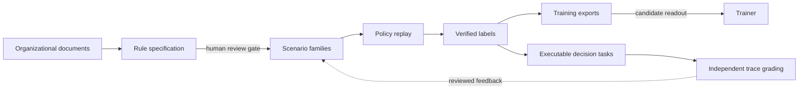

# Decision Forge

[](https://github.com/Juneo-Lab/decision-forge/actions/workflows/ci.yml)
[](https://juneo-lab.github.io/decision-forge/)
[](pyproject.toml)
[](LICENSE)
[](ROADMAP.md)

**English** · [简体中文](README.zh-CN.md)

**Compile organizational policy into verifiable decision training data.**

Organizations already know how their work should be decided — the policies, thresholds, escalation
rules, and acceptance criteria live in handbooks, SOPs, and workflow definitions. That knowledge is
written for people, not for model training, and nobody can prove a synthetic dataset derived from it
is correct.

Decision Forge closes that gap. It reads organizational documents, compiles them into an explicit
rule specification, and generates decision examples whose every label is re-derived from those rules
and whose every claim is traceable to an exact quotation in the source. The output is training data
you can audit, reproduce, and hand to a trainer.



**Status: `v0.3` — offline pipeline complete, training handoff aligned.**
The full pipeline runs end to end without credentials; model calls are explicit, budgeted, and
optional. See [supported scope](#supported-scope-in-this-release) for what this release does and does
not claim.

| | |
|---|---|
| Pipeline | documents → rules → scenarios → verified labels → exports, fully offline |
| Labels | re-derived from declared rules by a deterministic interpreter |
| Provenance | exact source span + locator for every rule |
| Tests | 218 tests, 87% statement coverage, 9 CI checks on Linux and macOS |
| Training | four export formats, including a candidate-readout decision contract |
| Language | Python 3.11+ |

## The four decision surfaces

Every workflow is reduced to the same four judgments, so one specification can train a model to make
each of them:

| Surface | Question the model learns to answer |
| --- | --- |
| **Allocate work** | Which person or agent should own this task? |
| **Share information** | Which recipient may receive which information? |
| **Select actions** | Should the workflow execute, adjust, or request authorization? |
| **Evaluate outcomes** | Does the deliverable meet the acceptance criteria? |

## Quickstart

Requires Python 3.11+ and [uv](https://docs.astral.sh/uv/). No API keys, no model downloads.

```bash
git clone https://github.com/Juneo-Lab/decision-forge
cd decision-forge
uv sync --group dev

uv run decision-forge validate examples/customer_support/project.yaml
uv run decision-forge build    examples/customer_support/project.yaml --output runs/demo
uv run decision-forge export   runs/demo --output runs/demo-decision --format decision
```

The fictional `Northstar Support` example is deliberately small (one handbook, ~1.2 KB of policy) and
produces a complete, verified dataset:

| Output | Value |
| --- | --- |
| Accepted episodes | 336 (requested 336, realized 336) |
| By surface | 96 allocate · 96 share · 96 act · 48 evaluate |
| By split | 196 train · 84 development · 56 test, assigned per family |
| Rejected for having no permitted choice | 0 |
| Model calls | 0 |

Artifacts in `runs/demo/`: `episodes.jsonl`, `rejected.jsonl`, `distribution.json`, `dedup.json`,
`report.json`, `report.md`, a hash-bound `project.snapshot.json`, and an integrity-checked
`manifest.json`. Rebuilding reuses content-addressed scenario caches; changing an input is detected
and refused rather than silently mixed into the old run.

## Why the data is trustworthy

The pipeline is built around the assumption that a synthetic label is worthless unless an independent
mechanism re-derives it. Each guarantee below is enforced by code, not by convention, and each has a
regression test.

| Guarantee | How it is enforced |
| --- | --- |
| **Labels are computed, not generated** | A deterministic policy interpreter (priority, deny precedence, set-valued ties) evaluates every candidate. No model ever emits a label. |
| **Every rule is grounded** | Each rule cites a quote that must match the source exactly; the span and page/line locator are recomputed by the compiler, never trusted from the model. |
| **Human review is a gate, not a suggestion** | Compiled specs ship as drafts. `build` refuses to run until every rule, node, and conflict carries an accepted, content-bound review decision. |
| **Splits cannot leak** | Assignment is per scenario family, and global duplicate detection reports any input that appears in more than one split, keeping the held-out copy. |
| **Runs resume** | Extraction, synthesis, and builds checkpoint after each unit of work behind content-addressed digests; interrupted work resumes without re-calling or republishing. |
| **Model calls are budgeted** | Call and byte budgets are reserved before a request. Raising a budget resumes the same artifact; exceeding it fails closed. |
| **Nothing is fabricated to fill a quota** | When a requested distribution is unreachable, the build reports the shortfall and what would close it instead of inventing examples. |

## Training handoff

Four export formats share one split assignment, so every arm of an experiment sees the same held-out
families:

| Format | Shape | Use |
| --- | --- | --- |
| `decision` | Explicit `options` + aligned `target_probs`, family grouping, provenance | Candidate-readout training (recommended) |
| `canonical` | Input/target pair, set-valued labels preserved | Custom pipelines that keep ambiguity |
| `typed` | Choice question with per-candidate criteria | Constrained decoding / evaluation harnesses |
| `sft` | Chat messages with a single answer | Reference SFT baseline |

```bash
uv run decision-forge export runs/demo --output runs/train --format decision
uv run python scripts/finetune_evaluation.py prepare runs/demo --output runs/plan --budget-examples 2000
```

The `decision` format emits `objective: candidate_readout` rows with unit weights and full provenance.
[`decision_forge.training.encode_decision`](docs/decision-training.md) turns them into a native
non-thinking prefix: single-token candidate labels, target probabilities moved together with the
candidate order, no answer token appended, and truncation rejected rather than silently applied. A
trainer that only minimizes ordinary answer-token SFT loss cannot consume this encoding — the contract
states the required objective explicitly.

`scripts/finetune_evaluation.py` closes the loop: `prepare` freezes a dataset digest and writes a
pinned handoff plan; `evaluate` scores any endpoint on that frozen held-out split; `compare` refuses
arms scored on different digests. **No fine-tuning has been run**, so this repository does not claim
that its data improves a model's decisions — that evidence is the next milestone.

## Compile your own documents

```bash
export FORGE_API_KEY="your-provider-key"
uv run decision-forge compile-corpus ./private/corpus.yaml --output runs/acme \
  --base-url https://your-model-host.example/v1 --model your-model

uv run decision-forge review-status runs/acme/project.json
uv run decision-forge review-record runs/acme/project.json \
  --item rule:refund-threshold --decision accepted \
  --reviewer you --reason "Matches §3.2 of the refund handbook." \
  --fingerprint FINGERPRINT_FROM_REVIEW_STATUS
uv run decision-forge build runs/acme/project.json --output runs/acme-data
```

Accepted inputs are text, Markdown, JSON, YAML, and PDF (with the `documents` extra), each with
version and access metadata. Extraction is chunked and resumable; assembly rejects any rule whose
evidence is not an extracted claim span. Unsupported or unknown state paths, ambiguous quotations, and
rule conflicts are rejected with a specific reason rather than patched. Credentials and raw model
responses are never written to build artifacts.

An optional [recipe planner](docs/generation.md) turns a requested distribution into exact per-cell
quotas, measures what the deterministic pool can supply, and separates work a model could do from work
only more source material can do. Verified synthesis (`expand`) then publishes only proposals whose
label is replayed from the declared policy.

## Evidence

**Offline (reproducible on any machine):** 218 tests, 87% statement coverage, Ruff, strict mypy, strict
MkDocs, wheel and sdist builds. CI runs 9 checks: quality, six test jobs (Ubuntu and macOS × Python
3.11/3.12/3.13), pinned Data Designer and LangGraph adapter contracts, and Harbor task execution in
Docker under oracle and no-op controls.

**Throughput:** ~3.7k accepted episodes per second, near-linear to 11,200 episodes, with the dataset
digest asserted identical across cold and warm runs. Host, versions, and protocol are recorded in
[benchmarks](docs/benchmarks.md).

**Live model runs (archived in `experiments/`, fictional inputs):**

| Experiment | Models | Result | Recorded cost |
| --- | --- | --- | --- |
| Document compilation | Claude Opus 5.5, GPT-6.1 Sol | 13/13 exact claims each; 31/32 decision agreement each | $0.29 / $0.15 |
| Multi-step workflows | Same two models | 3/3 tasks, 11/11 permitted decisions each | $0.036 total, 22 calls |

Every failed attempt, rejected review item, and unknown cost is preserved rather than retried away.
These results establish compatibility on small fictional inputs; they are not a benchmark of real
organizational performance.

## Supported scope in this release

**Supported**

- Text, Markdown, JSON, YAML, and PDF organizational sources with versions and access metadata.
- Document compilation into rules, nodes, candidates, and scenarios, with a content-bound review gate.
- Deterministic label derivation for all four decision surfaces.
- Distribution quotas, feasibility reporting, verified synthesis, and global duplicate detection.
- Family-level split isolation with leak accounting; resumable, integrity-checked runs.
- Training exports in four formats, including the candidate-readout decision contract.
- Multi-step mock business workflows with independent trace grading and Harbor task export.
- Runtime event ingestion, reviewed development feedback, and split-preserving dataset updates.

**Not in this release**

- No fine-tuning experiment, so no measured downstream quality gain.
- No claim that model-authored rules are correct without business review; review is a required step.
- Large-corpus retrieval and cross-document rule resolution (single-pass assembly, 2 MB source / 1 MB
  claim budgets).
- Multi-harness model comparison and a Verifiers adapter.
- Signed releases, package publishing, and schema migration tooling.
- Generation of policy text by a model; synthesis proposes decision-time state only.

The [roadmap](ROADMAP.md) tracks each remaining acceptance item against a milestone.

## Documentation

| | |
| --- | --- |
| [Architecture](docs/architecture.md) | Component boundaries and data flow |
| [Specification](docs/specification.md) | Rule, scenario, and recipe semantics |
| [Organization compiler](docs/organization-compiler.md) | Ingestion, extraction, review, resumption |
| [Generation planning](docs/generation.md) | Quotas, verified synthesis, deduplication |
| [Decision training](docs/decision-training.md) | Export contract and candidate-readout encoding |
| [Platform workflows](docs/platform-workflows.md) | Multi-step tasks, grading, feedback, updates |
| [Data protocol](docs/data-protocol.md) | Evaluation protocol and reporting rules |
| [References](docs/references.md) | Prior art and integration candidates |

## Development

```bash
uv sync --group dev --group docs --extra documents
uv run ruff check . && uv run ruff format --check .
uv run mypy src
uv run pytest --cov=decision_forge --cov-fail-under=80
uv run mkdocs build --strict
uv build
```

Repository artifacts are written in English; this README is also maintained in
[Simplified Chinese](README.zh-CN.md). See [CONTRIBUTING.md](CONTRIBUTING.md) for the review bar and
label taxonomy, [GOVERNANCE.md](GOVERNANCE.md) for how decisions are made, [SUPPORT.md](SUPPORT.md) for
where to ask, and [SECURITY.md](SECURITY.md) for reporting vulnerabilities.

If you use Decision Forge in published work, cite it via [CITATION.cff](CITATION.cff). Signal changes
through [`CHANGELOG.md`](CHANGELOG.md); export formats are versioned, so cite the version you used.

Licensed under [Apache-2.0](LICENSE).
