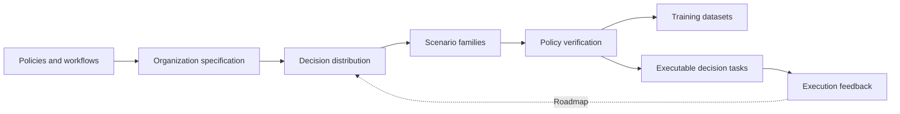

# Decision Forge

**Turn organizational workflows into verifiable decision training data.**

Decision Forge connects business policies, workflow decision points, controlled scenario families,
and training exports. It gives organizations a reproducible path from their operating knowledge
to the judgments that people and agents make throughout a workflow.

**Status: v0.1 foundation.** The offline pipeline works end to end. Document compilation uses an
explicitly configured model endpoint. Full workflow simulation and large-scale generation backends
are tracked in the [roadmap](ROADMAP.md).



## Four decision surfaces

| Surface | Questions the model learns to answer |
| --- | --- |
| **Allocate work** | Which person or agent should own this task? |
| **Share information** | Which recipient can receive which information? |
| **Select actions** | Should the workflow execute, adjust, or request authorization? |
| **Evaluate outcomes** | Does the deliverable meet the acceptance criteria? |

## Run the offline example

Requires Python 3.11+ and [uv](https://docs.astral.sh/uv/).

```bash
uv sync --group dev
uv run decision-forge validate examples/customer_support/project.yaml
uv run decision-forge build examples/customer_support/project.yaml --output runs/demo
uv run decision-forge export runs/demo --output runs/demo-typed --format typed
```

The example contains only fictional business policies. It runs locally without API keys or model
downloads. Outputs include verified episodes, rejected cases, coverage reports, a source snapshot,
and an integrity-checked build manifest. Repeating the build reuses cached scenario families.

```bash
uv run decision-forge impact examples/customer_support/project.yaml runs/demo
uv run decision-forge harbor-export runs/demo --output runs/harbor-tasks --split train --limit 8
```

## Compile your documents

Provide Markdown, text, JSON, or YAML files and an OpenAI-compatible endpoint supporting JSON
responses. This command sends the specified documents to that endpoint.

```bash
export FORGE_API_KEY="your-provider-key"
uv run decision-forge compile ./private/policy.md ./private/workflow.md \
  --base-url https://your-model-host.example/v1 --model your-model \
  --output runs/my-organization
uv run decision-forge validate runs/my-organization/project.json
```

The compiler checks structure, cross-references, and exact supporting quotations. The resulting
specification is a draft: business reviewers validate the interpretation of rules and preferences.
Use `review-status` and `review-record` to record review decisions, then run `build` to produce data. Keys and raw model responses are never
written to build logs. The single-request compiler supports source bundles up to 2 MB.
The [organization compiler](docs/organization-compiler.md) adds versioned text/PDF/workflow sources,
resumable chunk extraction, source spans, call budgets, and a content-bound review queue.

## What ships in v0.1

- Typed, versioned organization, policy, workflow, recipe, and episode contracts.
- A deterministic policy interpreter with explicit priority, deny precedence, and set-valued ties.
- Seeded conditional scenarios across all four decision surfaces.
- Family-level split assignment before augmentation and version-linked evidence.
- Content-addressed scenario caching, atomic artifacts, and input-change detection.
- Coverage reports and source-to-scenario impact analysis.
- Canonical, typed-choice, and chat SFT exports; ambiguous choices remain explicit.
- Offline prediction replay and portable single-step Harbor task exports.
- An optional document compiler for JSON Schema-capable model endpoints.

Labels in this release are verified against declared rules. Exact source matching establishes
provenance; independent business validation establishes whether the rule interpretation is correct.
The Harbor exporter packages individual decision tasks. Multi-step enterprise environments are
scheduled for M3.

## Architecture and integrations

The core stays small and works offline. Provider, generator, verifier, and harness boundaries support
incremental integration. Data Designer and LangGraph adapters, richer verification, and trace-driven
data updates have separate milestones and acceptance criteria.

- [Architecture](docs/architecture.md)
- [Project specification](docs/specification.md)
- [Data and evaluation protocol](docs/data-protocol.md)
- [Open-source design references](docs/references.md)
- [Milestones](ROADMAP.md)
- [Contributing](CONTRIBUTING.md)

## Development

```bash
uv sync --group dev --group docs
uv run ruff check .
uv run ruff format --check .
uv run mypy src
uv run pytest --cov=decision_forge
uv run mkdocs build --strict
uv build
```

All code, documentation, examples, issues, and public discussion templates are written in English.
See [CONTRIBUTING.md](CONTRIBUTING.md) for the development process and [SECURITY.md](SECURITY.md)
for reporting vulnerabilities. Licensed under [Apache-2.0](LICENSE).
