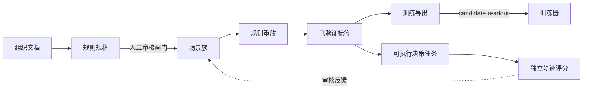

# Decision Forge

[](https://github.com/Juneo-Lab/decision-forge/actions/workflows/ci.yml)
[](https://juneo-lab.github.io/decision-forge/)
[](pyproject.toml)
[](LICENSE)
[](ROADMAP.md)

[English](README.md) · **简体中文**

**把组织制度编译成可验证的决策训练数据。**

组织本来就知道事情应该怎么决策——政策、阈值、升级规则、验收标准，都写在手册、SOP 和流程定义里。
但这些知识是写给人看的，不是写给模型训练的；而且没有人能证明由它派生的合成数据集是对的。

Decision Forge 补的就是这个缺口。它读取组织文档，编译成一份显式的规则规格，再生成决策样本：
**每一个标签都由规则重新推导，每一条主张都能追溯到原文中的精确引用**。产出的是可以审计、可以复现、
可以直接交给训练器的数据。



**状态：`v0.3` —— 离线管线完整，训练交接已对齐。**
整条管线无需任何凭证即可跑通；模型调用是显式的、有预算的、可选的。本版本做了什么、不声称什么，
见[支持范围](#本版本的支持范围)。

| | |
|---|---|
| 管线 | 文档 → 规则 → 场景 → 已验证标签 → 导出，全程离线 |
| 标签 | 由确定性解释器从声明规则重新推导 |
| 溯源 | 每条规则都有精确的源文本跨度与定位符 |
| 测试 | 218 个测试，87% 语句覆盖率，Linux 与 macOS 上共 9 项 CI |
| 训练 | 四种导出格式，含 candidate-readout 决策契约 |
| 语言 | Python 3.11+ |

## 四类决策面

任何流程都被归约成同样的四类判断，因此一份规格可以同时训练模型做这四件事：

| 决策面 | 模型要学会回答的问题 |
| --- | --- |
| **分配工作** | 这个任务应该由谁负责？ |
| **共享信息** | 哪个接收方可以拿到哪部分信息？ |
| **选择行动** | 流程应当直接执行、调整，还是申请授权？ |
| **验收结果** | 交付物是否满足验收标准？ |

## 快速开始

需要 Python 3.11+ 与 [uv](https://docs.astral.sh/uv/)。不需要 API key，也不需要下载模型。

```bash
git clone https://github.com/Juneo-Lab/decision-forge
cd decision-forge
uv sync --group dev

uv run decision-forge validate examples/customer_support/project.yaml
uv run decision-forge build    examples/customer_support/project.yaml --output runs/demo
uv run decision-forge export   runs/demo --output runs/demo-decision --format decision
```

`Northstar Support` 示例是刻意做小的（一份手册、约 1.2 KB 制度文本），但产出的是完整、已验证的数据集：

| 产出 | 数值 |
| --- | --- |
| 接受样本 | 336（请求 336，实际 336） |
| 按决策面 | 分配 96 · 共享 96 · 行动 96 · 验收 48 |
| 按切分 | 训练 196 · 开发 84 · 测试 56，按场景族分配 |
| 因"无任何允许选项"被拒 | 0 |
| 模型调用 | 0 |

`runs/demo/` 下的产物：`episodes.jsonl`、`rejected.jsonl`、`distribution.json`、`dedup.json`、
`report.json`、`report.md`、带哈希绑定的 `project.snapshot.json`，以及带完整性校验的 `manifest.json`。
重建会复用内容寻址的场景缓存；输入变化会被检测并拒绝，而不是悄悄混进旧 run。

## 数据为什么可信

整条管线建立在一个前提上：**如果不能用独立机制重新推导，合成标签就是没有价值的**。下表每一项都由代码
强制，而不是靠约定，并且都有回归测试。

| 保证 | 强制方式 |
| --- | --- |
| **标签是算出来的，不是生成的** | 确定性策略解释器（优先级、拒绝优先、集合值平局）逐候选判定。没有任何模型产出标签。 |
| **每条规则都有出处** | 每条规则引用一段必须与源文本精确匹配的引文；跨度与页码/行号定位由编译器重算，从不采信模型输出。 |
| **人工审核是闸门，不是建议** | 编译产物以草稿交付。在每条规则、每个节点、每处冲突都带有"已接受且内容绑定"的审核记录之前，`build` 拒绝运行。 |
| **切分不会泄漏** | 按场景族分配，并由全局重复检测报告任何跨切分重复的输入，保留留出集那一份。 |
| **运行可恢复** | 抽取、合成、构建都在每个工作单元后按内容寻址摘要落检查点；中断后续跑不会重复调用、不会重复发布。 |
| **模型调用有预算** | 请求前预留调用与字节预算。提高预算可续跑同一个产物；超出则 fail-closed。 |
| **不伪造数据凑配额** | 请求的分布无法达成时，构建会报告缺口与"需要什么才能补上"，而不是造样本。 |

## 训练交接

四种导出格式共享同一套切分，因此实验的每个 arm 看到的留出族完全相同：

| 格式 | 形态 | 用途 |
| --- | --- | --- |
| `decision` | 显式 `options` ＋ 对齐的 `target_probs`、族分组、溯源 | candidate-readout 训练（推荐） |
| `canonical` | 输入/目标对，保留集合值标签 | 自己保留歧义的自定义管线 |
| `typed` | 选择题 + 每候选的判据 | 约束解码 / 评测框架 |
| `sft` | 单答案的 chat messages | 参考 SFT 基线 |

```bash
uv run decision-forge export runs/demo --output runs/train --format decision
uv run python scripts/finetune_evaluation.py prepare runs/demo --output runs/plan --budget-examples 2000
```

`decision` 格式产出 `objective: candidate_readout` 的行，权重为 1，带完整溯源；
[`decision_forge.training.encode_decision`](docs/decision-training.md) 把它们编码成原生非思考前缀：
单 token 候选标签、目标概率随候选顺序一起搬动、不追加答案 token、超长直接报错而不是静默截断。
**只用普通 answer-token SFT 损失最小化的训练器消费不了这个编码**——契约里明确写了所需的训练目标。

`scripts/finetune_evaluation.py` 负责闭环：`prepare` 冻结数据集摘要并写出钉死的交接计划；`evaluate`
用固定 prompt 在冻结的留出切分上给任意端点打分；`compare` 拒绝跨数据集摘要的比较。
**本仓库没有跑过任何微调**，因此不声称这些数据能提升模型的决策能力——那份证据属于下一个里程碑。

## 编译你自己的文档

```bash
export FORGE_API_KEY="your-provider-key"
uv run decision-forge compile-corpus ./private/corpus.yaml --output runs/acme \
  --base-url https://your-model-host.example/v1 --model your-model

uv run decision-forge review-status runs/acme/project.json
uv run decision-forge review-record runs/acme/project.json \
  --item rule:refund-threshold --decision accepted \
  --reviewer you --reason "Matches §3.2 of the refund handbook." \
  --fingerprint FINGERPRINT_FROM_REVIEW_STATUS
uv run decision-forge build runs/acme/project.json --output runs/acme-data
```

接受的输入是文本、Markdown、JSON、YAML 和 PDF（需 `documents` extra），每份都带版本与访问元数据。
抽取分块且可续跑；装配阶段会拒绝任何证据不是"已抽取 claim 跨度"的规则。不支持或未知的状态路径、
有歧义的引文、规则冲突都会被带具体原因拒绝，而不是被打补丁。凭证与原始模型响应从不写入构建产物。

可选的[配方规划器](docs/generation.md)会把请求的分布翻译成精确的按 cell 配额，实测确定性池能供给多少，
并把"模型能补的"与"只能靠更多源材料补的"分开；随后 `expand` 的验证式合成只发布那些标签能被规则
重新推导出来的提案。

## 证据

**离线（任何机器可复现）：** 218 个测试、87% 语句覆盖率、Ruff、strict mypy、strict MkDocs、
wheel 与 sdist 构建。CI 共 9 项：quality、6 个测试任务（Ubuntu 与 macOS × Python 3.11/3.12/3.13）、
钉死版本的 Data Designer 与 LangGraph 适配器契约、以及在 Docker 中以 oracle 与 no-op 对照运行 Harbor 任务。

**吞吐：** 约 3.7k 接受样本/秒，到 11,200 条仍近似线性；冷/热两次运行的数据集摘要被断言一致。
主机、版本与协议记录在[基准测试](docs/benchmarks.md)。

**真实模型运行（归档在 `experiments/`，输入为虚构）：**

| 实验 | 模型 | 结果 | 记录成本 |
| --- | --- | --- | --- |
| 文档编译 | Claude Opus 5.5、GPT-6.1 Sol | 各自 13/13 精确 claim；各自 31/32 决策一致 | $0.29 / $0.15 |
| 多步工作流 | 同上两个模型 | 各自 3/3 任务、11/11 允许决策 | 合计 $0.036，22 次调用 |

每一次失败尝试、被拒的审核项、未知的成本都被保留而不是重试掉。这些结果只在小规模虚构输入上建立
兼容性，**不是真实组织性能的基准**。

## 本版本的支持范围

**支持**

- 文本、Markdown、JSON、YAML、PDF 组织源材料，带版本与访问元数据。
- 文档编译为规则、节点、候选与场景，并带内容绑定的审核闸门。
- 四类决策面的确定性标签推导。
- 分布配额、可行性报告、验证式合成、全局重复检测。
- 场景族级切分隔离与泄漏记账；可续跑、带完整性校验的运行。
- 四种训练导出格式，含 candidate-readout 决策契约。
- 多步模拟业务工作流，独立轨迹评分与 Harbor 任务导出。
- 运行事件接入、经审核的开发反馈、保持切分不变的数据集更新。

**本版本不包含**

- 没有微调实验，因此没有测得的下游质量提升。
- 不声称模型生成的规则无需业务审核就是正确的；审核是必需步骤。
- 大语料检索与跨文档规则合并（单次装配，2 MB 源 / 1 MB claim 预算）。
- 多 harness 模型对比与 Verifiers 适配器。
- 签名发布、包发布、schema 迁移工具。
- 由模型生成策略文本；合成只提出决策时刻的状态。

每一项剩余验收项都在[路线图](ROADMAP.md)中对应到里程碑。

## 文档

| | |
| --- | --- |
| [架构](docs/architecture.md) | 组件边界与数据流 |
| [规格](docs/specification.md) | 规则、场景与配方语义 |
| [组织编译器](docs/organization-compiler.md) | 接入、抽取、审核、续跑 |
| [生成规划](docs/generation.md) | 配额、验证式合成、去重 |
| [决策训练](docs/decision-training.md) | 导出契约与 candidate-readout 编码 |
| [平台工作流](docs/platform-workflows.md) | 多步任务、评分、反馈、更新 |
| [数据协议](docs/data-protocol.md) | 评测协议与报告规则 |
| [基准测试](docs/benchmarks.md) | 离线吞吐协议与参考数据 |
| [参考](docs/references.md) | 相关工作与集成候选 |

## 开发

```bash
uv sync --group dev --group docs --extra documents
uv run ruff check . && uv run ruff format --check .
uv run mypy src
uv run pytest --cov=decision_forge --cov-fail-under=80
uv run mkdocs build --strict
uv build
```

仓库产物以英文撰写；本 README 另有[英文原文](README.md)。贡献评审门槛见
[CONTRIBUTING.md](CONTRIBUTING.md)，决策方式见 [GOVERNANCE.md](GOVERNANCE.md)，提问渠道见
[SUPPORT.md](SUPPORT.md)，漏洞报告见 [SECURITY.md](SECURITY.md)。

若在发表工作中使用 Decision Forge，请通过 [CITATION.cff](CITATION.cff) 引用；导出格式是版本化的，
请注明所用版本。许可证为 [Apache-2.0](LICENSE)。
